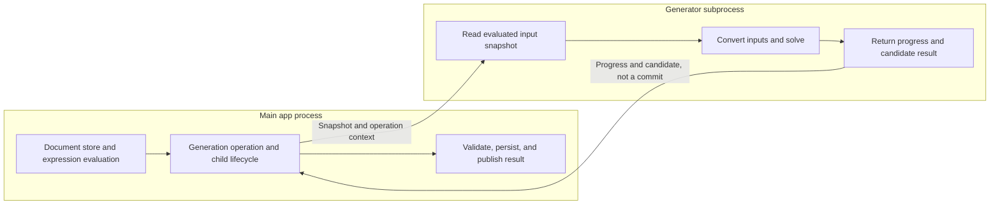

# Generator Process Boundary

`generator` is the C++ trajectory-generation executable. In the planned app
architecture, the main application starts and owns it as a subprocess. The
application-side launcher and subprocess protocol are not implemented yet.

## Main App Responsibilities

- Own the active document, evaluate expressions, and select an immutable project
  and trajectory snapshot for each generation operation.
- Start and reap the generator, associate it with an operation and input
  revision, forward bounded progress, handle cancellation and process failure,
  and clean up children on shutdown.
- Check the result and input revision, decide whether it is stale, and persist
  and publish accepted changes through the document commit lane. The app owns
  undo/redo and user-visible operation status.

These responsibilities belong to the future app/server integration, not the
shared `choreo::document_core` library. The current `cpp/choreo_app` project
provides a document store but does not yet manage generator processes or provide
the required durable multi-file commit.

## Generator Responsibilities

- Validate generation inputs, map document values to Trajopt types, build the
  optimization problem, solve it, and convert samples to WPILib types.
- Return intermediate progress and a candidate trajectory result. It does not
  own the live application document or decide whether a result is committed.
- Keep process-specific input/output and progress transport separate from the
  conversion and solving logic so they can be tested independently.

The current code places CLI and file I/O plus result assembly in
`src/main.cpp`, argument parsing in `src/cli_parser.cpp`, segment preparation in
`src/split_to_segments.cpp`, and conversions and solving in `include/`. The
progress sender is in `../progress-update-sender`. The executable reads files
directly and can write `--output`; it does not yet implement an app-owned
snapshot handoff, revision check, cancellation protocol, or durable commit.
Its complete-trajectory WebSocket message is a candidate result, not an app
commit acknowledgment. The app must not give it authoritative output paths.

The transport and operation envelope remain to be designed, including snapshot
ownership, temporary-file cleanup if files are used, progress limits, terminal
status, and cancellation. The existing CLI and progress message formats are
starting points, not a complete subprocess protocol.