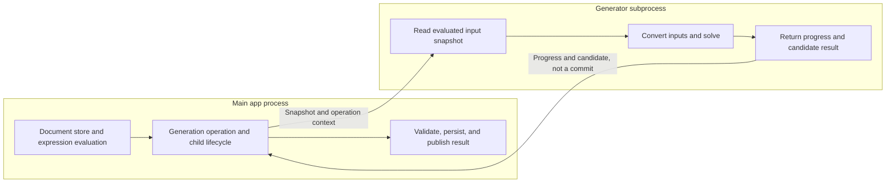

# Generator Process Boundary

`generator` is the C++ trajectory-generation executable. In the planned app
architecture, the main application starts and owns it as a subprocess. An
initial app-side handoff is implemented in `cpp/choreo_app`; server integration
and a complete operation protocol are still pending.

## Main App Responsibilities

- Own the active document, evaluate expressions, and select an immutable project
  and trajectory snapshot for each generation operation.
- Start and reap the generator, associate it with an operation and input
  revision, forward bounded progress, handle cancellation and process failure,
  and clean up children on shutdown.
- Check the result and input revision, decide whether it is stale, and persist
  and publish accepted changes through the document commit lane. The app owns
  undo/redo and user-visible operation status.

These responsibilities belong to the app/server integration, not the shared
`choreo::document_core` library. `choreo::generation_process` provides an
in-tree WPILib-based child process and snapshot handoff when `wpinet` is
available. It does not provide the required durable multi-file commit.

## Generator Responsibilities

- Validate generation inputs, map document values to Trajopt types, build the
  optimization problem, solve it, and convert samples to WPILib types.
- Return intermediate progress and a candidate trajectory result. It does not
  own the live application document or decide whether a result is committed.
- Keep process-specific input/output and progress transport separate from the
  conversion and solving logic so they can be tested independently.

The current code places CLI and file I/O plus result assembly in
`src/main.cpp`, argument parsing in `src/cli_parser.cpp`, segment preparation in
`src/split_to_segments.cpp`, progress transport in
`src/progress_update_sender/`, and conversions and solving in `include/`. The app writes temporary
input snapshots and reads a temporary `--output` after a successful child exit;
it rejects stale or mismatched results and commits the complete trajectory as
one store update. The optional progress URL is passed through to the child;
progress receiving and forwarding are not implemented by the handoff. Its
complete-trajectory WebSocket message is a candidate, not an app commit
acknowledgment. The app must not give it authoritative output paths.

The handoff must be polled or waited on and committed on the store's owning
thread. Cancellation currently force-terminates the child. Temporary files are
removed on destruction; abrupt process exit can leave them behind. Operation
IDs, bounded progress forwarding, graceful cancellation, crash cleanup, and a
durable commit protocol remain to be designed.